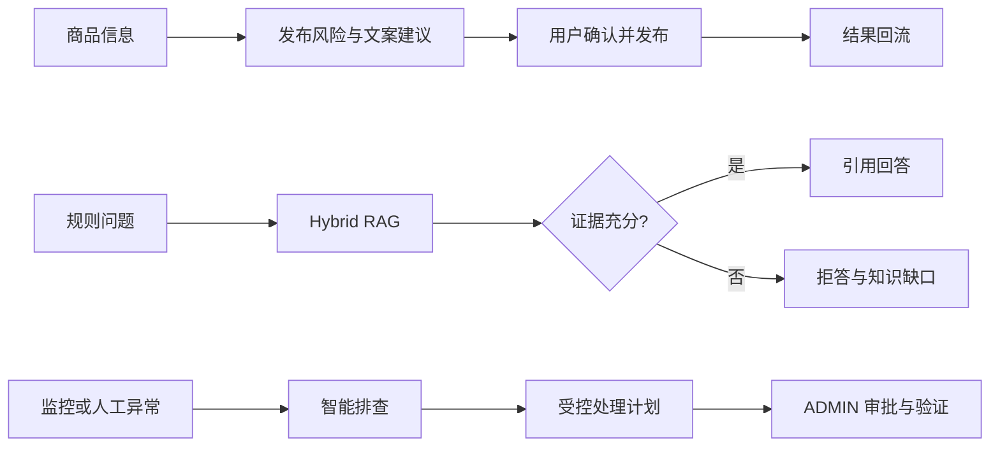

# 回血集市：RAG + Agent 二手交易平台

回血集市是一个面向二手交易的可信发布与知识问答平台，并为内部人员提供可审批、可验证的智能故障处理能力。项目只围绕三条产品链路展开，RAG、Agent、Harness 和多存储治理都是完成这些业务链路的支撑手段。

## 三条产品链路

| 使用者 | 场景 | 完整结果 |
|---|---|---|
| 卖家 | 商品发布 | 填写商品 -> AI 检查风险与文案 -> 用户采纳 -> 发布结果回流 |
| 买卖双方 | 平台规则咨询 | 混合检索 -> 引用规则回答或拒答 -> 低置信度问题沉淀为知识缺口 |
| INTERNAL / ADMIN | 内部故障处理 | 发现异常 -> Agent 调查 -> 生成计划 -> 审批执行 -> 健康验证或转人工 |



## 可验证结果

- RAG Development v5：32/32 完整召回，ID Context Recall `1.000`；首次 Holdout v6 为 `0.756`、Precision `0.544`，未达检索门槛，保留未知问法泛化边界。
- AIOps 持续发现 27/27、修复闭环 16/16；真实写操作必须经过审批，失败进入 `ESCALATED`。
- Durable Runtime 15/15，恢复成功率 100%，固定用例中重复副作用为 0。

完整指标口径见 [评测摘要](docs/benchmarks/README.md)，五分钟演示顺序见 [演示清单](docs/FIVE_MINUTE_DEMO_CHECKLIST.md)。工程文档入口见 [文档索引](docs/README.md)。

## 权限边界

| 角色 | 主要能力 |
|---|---|
| `USER` | 浏览、发布、发布助手、RAG 问答、本人反馈 |
| `INTERNAL` | 查看告警、证据、Trace，发起受控计划和 dry-run |
| `ADMIN` | 审批/拒绝计划，执行白名单 Runbook，管理知识版本 |

真实修复不能从旧 Runbook 接口直接执行，必须经过 `PENDING_APPROVAL -> APPROVED -> EXECUTING -> VERIFYING -> RESOLVED/ESCALATED`。API 只接收逻辑动作和白名单目标，不接收任意命令。

## 可靠性设计

2026-10-13 补充分页、订单条件更新、上传鉴权与 MIME 校验、聊天限流、监控鉴权以及发布反馈提交后关联。逐项结论与联调步骤见 [架构修复记录](docs/specs/architecture-hardening-review-and-repair.md)。

L1 最近对话默认使用 Redis，L3 摘要沿用 MySQL 版本化存储。HTTP/WS Origin 共用 `APP_CORS_ALLOWED_ORIGINS`；远程访问需显式配置。Prometheus 抓取需配置 `PROMETHEUS_SCRAPE_TOKEN` 并挂载同值文件至 `/etc/prometheus/secrets/app-token`；可用 `MANAGEMENT_PORT` 分离管理端口，默认为现有业务端口。

- Tool Execution Harness：超时、有限重试、Redis 快照恢复、fallback 和 Micrometer 指标。
- Durable Agent Runtime：DAG checkpoint、暂停/恢复、幂等、重放和只读重放。
- Token Governance：按场景设置输入/输出预算，裁剪低优先级上下文并记录用量。
- RAG 防护：上传类型/MIME 校验、Prompt Injection 隔离、证据引用、拒答和价格忠实度约束。
- 三存储治理：以稳定 `chunkId` 对齐 MySQL、Elasticsearch 和 Milvus，修复后重新验证。

## 技术栈

- Backend: Java 17, Spring Boot 3.5, Spring AI 1.0.3, Spring Security, MyBatis-Plus
- Storage: MySQL, PostgreSQL, Redis, Elasticsearch 8, Milvus, MinIO
- Messaging/Observability: RabbitMQ, Prometheus, Alertmanager, Micrometer
- Frontend: Vue 3, TypeScript, Pinia, Vue Router, Axios, Vite
- Evaluation: Python contract eval, RAGAS, DeepEval, JUnit 5, Mockito

## 快速启动

### 1. 准备数据与环境变量

```powershell
mysql -u root -p < sql/used_market.sql
mysql -u root -p used_market < sql/marketplace_demo_seed.sql
Copy-Item .env.example .env
```

在系统环境变量、IDEA Run Configuration 或当前 PowerShell 会话中设置真实凭证。不要把 `.env`、JWT、模型 Key 或 SSH 私钥提交到仓库。

最少需要配置：

```powershell
$env:MYSQL_PASSWORD = "<mysql-password>"
$env:JWT_SECRET = "<at-least-32-byte-secret>"
$env:OPENAI_API_KEY = "<openai-compatible-key>"
$env:REDIS_PASSWORD = "<redis-password>"
```

完整变量见 [.env.example](.env.example)。IDEA 本机调试可使用 `idea` profile；本机 `application-idea.yml` 不提交 Git。首次拉取可从示例生成本机覆盖配置：

```powershell
Copy-Item src/main/resources/application-idea.example.yml src/main/resources/application-idea.yml
```

### 2. 启动后端

```powershell
.\scripts\start-backend.ps1
# 或 IDEA 启动时添加 Active profiles: idea
```

Swagger: `http://localhost:8080/swagger-ui.html`

### 3. 启动前端

```powershell
.\scripts\start-frontend.ps1
```

Frontend: `http://localhost:5173`

### 4. 演示预检

在新的 PowerShell 窗口中设置三个角色的临时 Token，然后执行只读预检：

```powershell
$env:DEMO_USER_TOKEN = '<user-token>'
$env:DEMO_INTERNAL_TOKEN = '<internal-token>'
$env:DEMO_ADMIN_TOKEN = '<admin-token>'
.\scripts\smoke-test.ps1 -DocId 19 -Strict
```

预检只读取健康状态、权限边界和三存储一致性，不会审批计划、Repair、重启或删除容器。

## 验证

后端全量测试：

```powershell
.\mvnw.cmd -q test
```

多 Agent 与受控操作核心回归：

```powershell
.\mvnw.cmd -q "-Dtest=BuiltinSupervisorCollaborationEngineTest,MetricsSpecialistAgentTest,AiopsRunbookServiceImplTest,ControlledOperationServiceImplTest" test
```

前端构建：

```powershell
cd used_marketplace_frontend
npm run build
```

Python 评测命令集中在 [docs/EVAL_SCRIPT_COMMANDS.md](docs/EVAL_SCRIPT_COMMANDS.md)，数据集位于 `eval/datasets/`，生成报告写入本地 `eval/reports/`（不提交 Git）。

## 评测快照

以下结果来自本地固定数据集，不等同于线上 SLA：

| 链路 | 数据集/框架 | 最近结果 |
|---|---|---|
| RAG 开发集 | RAGAS Development v5, 32 cases | Gate PASS；检索 P95 727 ms；端到端 P95 1.834 s |
| RAG 盲测 | RAGAS Holdout v6, 30 cases, Judge=false | `RISK`；Context Recall 0.756、Precision 0.544；旧 v4 Judge 结果保留为历史证据 |
| Planner/Replan | 13 live cases | 13/13；4 条真实结构化 LLM 规划、2 条有限 Replan |
| Agent | DeepEval, 8 cases | 工具正确性 1.0，最小权限 1.0；未启用 Task Completion Judge |
| AIOps 持续发现 | 27 stateful cases | 27/27，P95 525.0 ms |
| 修复闭环 | 16 cases | 16/16，包含审批、验证、升级和 MTTR |
| Durable Runtime | 15 cases | 15/15，恢复成功率 100%，重复副作用 0 |
| 文档入库 | MD/PDF/DOCX/异常样例，20 cases | 20/20，P95 2.324 s |
| 隔离 Docker Runbook | 10 JUnit + 7 live API cases | 单元测试 10/10、VM 实机 API 7/7；不健康夹具触发真实回滚并恢复 HTTP 200 |

这组数据主要用于回归和比较版本，不把针对开发集调优后的通过率当作未知问题泛化结论。

## 隔离 Docker Runbook

`DOCKER_RESTART_VERIFY_ROLLBACK` 只允许操作独立演示目标 `marketplace-demo-web`。执行链路为：

```text
INTERNAL 创建计划 -> ADMIN 审批 -> 固定 helper 重启容器
-> HTTP 健康检查 -> 失败时用固定镜像重建 -> 再次验证
-> RESOLVED 或 ESCALATED + trace/audit
```

VM 侧安装说明见 [deploy/runbook/README.md](deploy/runbook/README.md)。应用默认禁用该动作；启用时使用 SSH 公钥和 root-owned helper，不能传入容器名、镜像、端口或 shell 命令。演示容器使用独立 bridge 网络，测试结束后由 `cleanup` 删除；PostgreSQL、ES、Milvus 等项目依赖不在白名单内。

## 目录

```text
src/main/java/.../modules/ai/  RAG、Agent、AIOps、Memory、Runtime
src/test/java/.../modules/ai/  关键单元与状态机测试
used_marketplace_frontend/     Vue 3 前端
eval/datasets/                 固定评测集与 holdout manifest
eval/fixtures/                 MD/PDF/DOCX 上传样例
tools/                         Python 评测脚本
deploy/                        Alertmanager、Prometheus、隔离 Runbook
docs/specs/                    Spec、验收条件与追踪材料
```

## 当前边界

- 这是单业务域 AIOps MVP，不是通用 SRE 平台；真实写操作仅覆盖白名单演示容器和知识库治理动作。
- 多 Agent 是确定性的 Supervisor + specialist 并行协作，不宣称自治 Agent 间自由对话。
- 模型和基础设施由外部服务提供；未配置模型 Key 时部分链路会进入规则降级，不能据此评价 LLM 效果。
- 短信发送和支付仍是演示实现，不应用于真实交易。

## License

[MIT](LICENSE)
