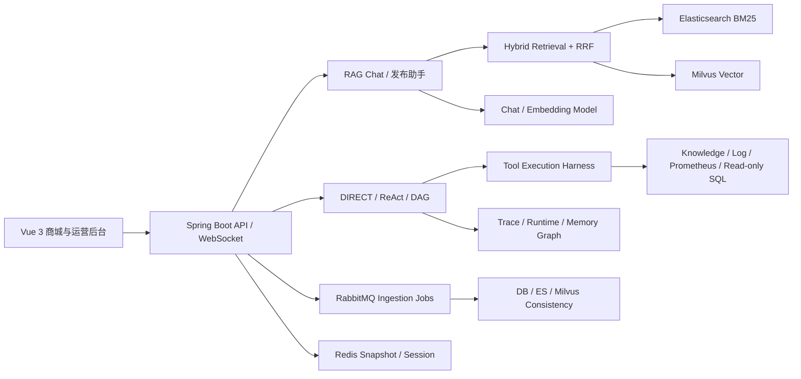

# 回血集市：RAG + Agent 二手交易智能平台

面向二手电商的商品发布、知识问答与内部运维场景，项目将混合检索、可信 RAG、Agent 工具编排、受控修复和离线评测组合成可追踪的 AI 应用闭环。

## 核心能力

- **智能知识检索**：Milvus 向量召回与 Elasticsearch BM25 关键词召回，经 RRF 融合后完成过滤、去重和低置信度判断。
- **可信发布助手**：保留型号、容量、维修史等输入事实，支持风险证据、硬风险阻断、否定语境识别和模型失败降级。
- **RAG 对话**：WebSocket 流式回答、证据引用、证据不足拒答、价格信息忠实度约束与知识缺口沉淀。
- **智能排查**：统一入口按任务复杂度路由 DIRECT、ReAct 或 DAG，并通过 USER、INTERNAL、ADMIN 权限隔离工具能力。
- **受控运维**：诊断、审批、执行、验证、转人工完整闭环；Durable Runtime 提供 checkpoint、恢复、幂等与重放。
- **可靠性治理**：Tool Execution Harness 提供超时、重试、Redis 快照和 fallback；RabbitMQ 异步处理知识入库、Repair 与 reindex。
- **知识库治理**：DB、Elasticsearch、Milvus 三存储一致性检查，以及 Repair API、任务状态和版本化入库。

## 架构



## 评测快照

| 能力 | 当前固定评测结果 |
| --- | --- |
| 混合检索 hard cases | Recall@5 100%，MRR 0.93 |
| 发布字段保真与风险判断 | 12/12；事实保真 100%，硬风险召回 100%，安全误杀 0% |
| Hybrid Planner | 8/8 |
| AIOps 修复闭环 | 16/16 |
| Durable Agent Runtime | 15/15 |
| Token 治理预算预览 | 8/8 |

固定数据集位于 [`eval/datasets`](eval/datasets)，报告位于 [`eval/reports`](eval/reports)，执行命令见 [`docs/EVAL_SCRIPT_COMMANDS.md`](docs/EVAL_SCRIPT_COMMANDS.md)。指标只代表仓库内固定评测集，不等同于生产流量效果。

## 技术栈

Spring Boot、Spring AI、MyBatis-Plus、MySQL、PostgreSQL、Redis、RabbitMQ、Milvus、Elasticsearch、Prometheus、MinIO、WebSocket、Vue 3、TypeScript。

## 本地启动

### 1. 环境要求

- JDK 17+
- Node.js 22.18+（Vite 8 / Babel 8 依赖要求）
- MySQL 8、PostgreSQL 16、Redis、RabbitMQ
- Milvus、Elasticsearch 8、MinIO、Prometheus
- OpenAI-compatible Chat 与 Embedding API

### 2. 配置环境变量

复制 [`.env.example`](.env.example) 的变量到本地环境并替换所有 `change-me`。至少需要配置：

```text
MYSQL_PASSWORD
OPENAI_API_KEY
JWT_SECRET
REDIS_PASSWORD
RABBITMQ_PASSWORD
MINIO_ACCESS_KEY
MINIO_SECRET_KEY
MEMORY_GRAPH_PG_PASSWORD
```

不要提交 `.env`、`application-local.yml` 或真实 Token。`application-idea.yml` 也只引用环境变量，服务地址可以按本机或虚拟机环境覆盖。

### 3. 后端

```powershell
.\mvnw.cmd test
.\mvnw.cmd spring-boot:run
```

Swagger：`http://localhost:8080/swagger-ui.html`

### 4. 前端

```powershell
cd used_marketplace_frontend
npm ci
npm run dev
```

默认开发地址：`http://localhost:5173`

## 角色边界

| 角色 | 能力 |
| --- | --- |
| USER | 商城、发布助手、RAG 对话 |
| INTERNAL | 智能排查、只读工具、Trace 与指标查看 |
| ADMIN | 知识治理、审批、受控 Repair 与风险结果回流 |

所有高风险执行均由后端鉴权和状态机约束，前端菜单隐藏不作为权限控制。

## 文档入口

- [开发记录](agent.md)
- [开发清单](docs/DEVELOPMENT_CHECKLIST.md)
- [核心代码导读](docs/PROJECT_CORE_CODE_WALKTHROUGH.md)
- [最终验收追踪表](docs/specs/final-acceptance-traceability.md)
- [五分钟演示清单](docs/FIVE_MINUTE_DEMO_CHECKLIST.md)
- [安全威胁模型](docs/security/Online_used_marketplace-threat-model.md)

## 安全说明

仓库只保留环境变量名和示例占位值。生产环境应使用独立密钥管理、最小权限账号、HTTPS、私有网络和数据库备份，并在部署前关闭 Debug/Fault Injection 接口。
