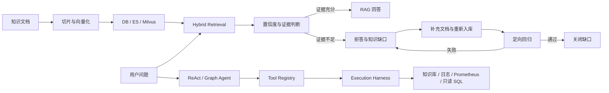
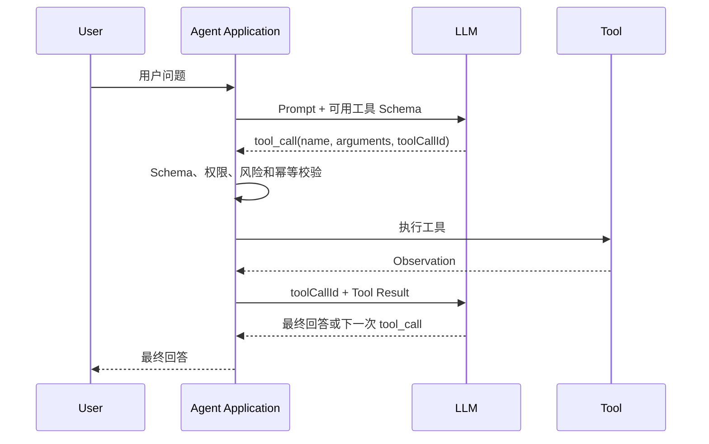

# 二手商城 RAG + Agent 核心代码解析

更新时间：2026-06-23

## 1. 阅读目标

要真正理解本项目，优先吃透以下五条链路：

1. 文档如何变成可检索的 chunk，并保持 DB、ES、Milvus 三边一致。
2. 用户问题如何经过向量检索、关键词检索和 RRF 融合形成证据。
3. RAG Chat 如何组装记忆、判断证据可信度、约束回答并沉淀知识缺口。
4. ReAct/Graph Agent 如何选择工具，以及 Harness 如何保护工具执行。
5. 评测结果如何反向驱动知识修复、回归验证和指标统计。

这五条链路共同构成项目主闭环：



## 2. 知识入库与三存储一致性

### 2.1 核心入口

- Controller：`KnowledgeDocController`
- 主服务：`KnowledgeIndexServiceImpl`
- 一致性检查：`KnowledgeStorageConsistencyServiceImpl`
- 异步入口：`KnowledgeIndexTaskPublisher` 与 RabbitMQ Consumer

`KnowledgeIndexServiceImpl` 同时提供三种任务：

- `triggerIngest`：首次入库。
- `triggerReindex`：强制重建索引。
- `repairDoc/repairBatch`：发现三存储不一致后修复。

每次操作先写入 `KnowledgeIndexTask`，任务状态记录 `PENDING/QUEUED/RUNNING/SUCCESS/FAILED/DEAD_LETTERED`，阶段记录 `CREATED/CLEANUP/SPLIT/DB_WRITE/EMBEDDING/VECTOR_WRITE/ES_WRITE/VERIFY/FINISHED`。

### 2.2 同步和异步分发

`dispatch` 根据 `async` 选择执行方式：

```text
async=false -> 当前请求线程执行 executeTask
async=true  -> 标记 QUEUED -> 发布 RabbitMQ 消息 -> Consumer 抢占任务并执行
```

RabbitMQ 不可用时，代码不会悄悄改为同步执行，而是将任务标记为失败。这能避免调用方误以为任务已异步提交。

`claimTask` 通过数据库条件更新抢占任务，重复消息发现任务已经成功、运行中或进入死信后会跳过，因此消费端具备基本幂等性。

### 2.3 重建过程

`rebuildIndexes` 的实际顺序是：

1. 保留当前 ACTIVE 索引，调用 `ChunkingService.split` 生成 STAGING chunk。
2. 先写 DB，获得数据库生成的 `chunkId`。
3. 对 chunk 内容批量生成 embedding。
4. 使用同一个 `chunkId` 写入 Milvus。
5. 使用同一个 `chunkId` 写入 ES。
6. 回写 embedding model 和 vector reference，并查询三边 chunkId 验证 STAGING。
7. 验证通过才切换 ACTIVE；同文档旧 index generation 随后清理，跨 revision 的旧文档进入 RETIRED 保留期。

DB 必须先写，因为它是 chunk 身份的事实源。ES 和 Milvus 如果自己生成 ID，就无法可靠地做去重、引用定位和 Repair。

### 2.4 为什么 Repair 不是简单重试

Repair 会先检查当前状态：

- 三边已经一致且未指定 `forceReindex`：直接成功并记录 `skip`。
- 三边不一致或强制重建：完整执行清理、重建和验证。
- 重建后仍不一致：任务状态为 `FAILED`，不会返回“成功完成”。

因此 Repair 的语义是“检查 -> 重建 -> 验证 -> 状态落库”，而不是只重复一次写入请求。

## 3. Hybrid + RRF 检索

### 3.1 统一入口

核心类是 `KnowledgeSearchServiceImpl`，支持：

- `VECTOR_ONLY`：query embedding -> Milvus TopK。
- `KEYWORD_ONLY`：ES BM25 TopK。
- `HYBRID`：两路各召回候选集，再使用 RRF 融合。

`search(question, topK, filter, mode)` 负责模式分发。需要注意，旧的三参数重载当前默认走 `VECTOR_ONLY`，而 RAG Chat 和知识工具显式调用 Hybrid。新增调用代码时应明确传递 `RetrievalMode`，避免无意退回纯向量检索。

### 3.2 向量分支

`doVectorSearch` 的处理顺序：

```text
question -> EmbeddingService.embed -> float[] -> VectorStore.search
```

文档向量和 query 向量必须由同一 embedding 模型、同一维度生成。否则即使 Milvus 接受数据，也不存在可比较的统一语义空间。

`VectorStore` 是存储抽象，检索服务不直接依赖 Milvus SDK，便于替换实现和隔离基础设施细节。

### 3.3 关键词分支

`KeywordSearchService` 使用 ES BM25，主要补足以下场景：

- 商品型号、发票、配件等强关键词。
- 风险规则中的固定用语。
- 向量语义相近，但关键约束不同的文档。

如果 ES 不可用，旧实现可能走数据库 fallback。评测和线上 debug 必须观察 `debugInfo`，不能只看最终有无结果，否则可能误把 fallback 当成 ES 生效。

### 3.4 RRF 融合

Hybrid 先让两路各取 `max(topK, 20)` 条候选，再调用 `rrfFuse`：

```text
score(d) = sum(1 / (60 + rank(d) + 1))
```

同一个 chunk 同时出现在两路时，会累加两次排名分数。去重键优先使用 `docId#chunkId`，缺少 ID 时才退化为 snippet。

RRF 的价值不是“比加权一定更准”，而是避免直接混合 Milvus 相似度和 BM25 分数。这两类原始分数尺度不同，按排名融合更稳定，代价是丢失一部分原始置信度信息。

### 3.5 来源治理

两路结果进入 RRF 前都会执行 `applyGovernance`：

- 文档不存在：丢弃。
- 状态不是 `ACTIVE`（包括 `DRAFT`、`RETIRED`、`DISABLED`）：丢弃。
- 尚未生效或已经过期：丢弃。
- 补充来源可信等级、文档版本和有效期。

这一步说明检索命中不等于证据可用，来源状态是生成回答前的第二道约束。

## 4. RAG Chat 生成链路

核心类是 `RagChatServiceImpl`，主方法 `chat` 可以拆成六个阶段。

### 4.1 记忆与 Profile 组装

代码先从当前问题抽取偏好，再读取：

- L1：最近会话。
- L2：长期语义记忆。
- L3：当前 Session Summary 和 KV 自动填充参数。
- Profile：从长期偏好聚合出的结构化画像。

冲突原则是：本轮明确输入优先于 L3，L3 优先于长期 Profile。检测到用户切换商品时，旧 L3 不注入，避免上一件商品的事实污染当前问题。

当前实现会将部分问答以 `FACT`、`importance=0.3` 写入 L2；偏好通过规则和 LLM 双路抽取后写入长期记忆。

### 4.2 检索与空结果处理

RAG Chat 固定调用 `searchHybrid`。没有任何 hit 时不会调用 LLM，而是直接返回可解释拒答，并发布 `NO_RETRIEVAL` 或 `MISSING_FIELDS` 结果事件。

这能同时减少无证据生成和不必要的模型调用成本。

### 4.3 低置信度联合判定

当前综合分数为：

```text
confidence = 0.35 * normTop1
           + 0.15 * normTop3
           + 0.20 * lexicalCoverage
           + 0.15 * sourceDiversity
           + 0.10 * keywordSignal
           + 0.05 * marginBonus
```

- `>= 0.72`：HIGH。
- `>= 0.55`：MEDIUM。
- 其他：LOW。

此外，“这个东西能卖吗”一类缺少商品字段的问题会被规则强制判定为 `MISSING_FIELDS`，即便召回了泛化规则也不会直接作答。

这里的分数是项目经验公式，不是经过概率校准的真实置信度。面试时应说明它由 hard case 调参得到，后续可通过标注集做阈值校准，而不能说成模型概率。

### 4.4 Prompt 约束

证据充分时，Prompt 明确要求：

- 只基于检索证据回答。
- 不编造金额、比例、折扣、倍数和平台规则。
- 覆盖用户已经给出的型号、成色、配件和检测结果。
- Profile 只用于默认值和表达偏好，不能覆盖当前事实。

### 4.5 LLM 重试、fallback 与后处理

`ChatGenerationServiceImpl` 最多调用模型三次，按 `300ms * attempt` 退避。全部失败后抛出业务异常，RAG Chat 捕获后使用证据模板生成 fallback。

模型回答之后还会执行确定性后处理：

- 补齐被模型遗漏的用户关键字段。
- 检测证据中不存在的量化价格表达。
- 对弱拒答补充已有风险点和可执行建议。
- 对要求补图的规则追加图片或检测截图提醒。

这体现了两层防护：Prompt 降低出错概率，后处理保证关键业务约束。

### 4.6 结果事件

所有出口最终调用 `publishOutcome` 发布 `RagChatOutcomeEvent`：

- 正常回答也记录 RAG turn audit。
- 空召回和低置信度携带 reason code。
- 事件由知识缺口服务监听，RAG 主链路不直接依赖治理表写入逻辑。

事件监听失败只记录警告，不影响用户本次回答。这是业务可用性优先的取舍。

## 5. ReAct 与 Graph/DAG Agent

### 5.1 共享基础设施

两种 Agent 共用：

- `AgentToolRegistry`：收集所有 `AgentTool` Bean，并按名称查找。
- `ToolExecutionHarness`：超时、重试、快照和 fallback。
- `AgentRuntimeContextBuilder`：组装记忆和权限上下文。
- `ChatGenerationService`：根据 Observation 生成最终回答。
- Trace persistence：保存计划、工具调用、Observation 和异常。

### 5.2 当前 ReAct 的真实实现

`ReactAgentServiceImpl.run` 的流程是：

```text
校验请求 -> 组装 Runtime Context -> 规则生成工具计划
-> 按顺序执行工具 -> 汇总 Observation -> LLM 生成最终回答 -> 保存会话摘要
```

`plan` 根据关键词选择 `knowledge_search`、`log_query`、`prometheus_query`、`mysql_read`、`vector_debug` 和 `profile` 等工具。

必须准确说明：当前是 ReAct-style 的规则 Planner，不是完整的 LLM Thought -> Action -> Observation -> Replan 循环。计划生成后主要顺序执行，Observation 不会驱动下一轮动态工具选择。

这个设计的优点是稳定、可测试、调用成本低；缺点是面对未覆盖表达和复杂动态任务时泛化能力有限。

### 5.3 Graph/DAG 调度

`GraphReactAgentServiceImpl` 将工具计划转换成 DAG：

```text
多个 TOOL 节点 -> observation_merge -> final_answer
```

调度器为每个节点计算入度：

1. 入度为 0 的节点进入 ready queue。
2. 同一批 ready 节点通过 `CompletableFuture` 并行执行。
3. 节点完成后，将依赖它的后继节点入度减 1。
4. 后继节点入度变为 0 时进入下一批。
5. 最后比较 processed 数量和 graph size，发现循环或非法依赖。

当前图主要是“一层并行工具 + Merge + Final”，已经具备通用拓扑调度骨架，但尚未实现由 LLM 动态生成任意复杂任务图。

### 5.4 两者的区别

| 对比项 | ReAct | Graph/DAG |
| --- | --- | --- |
| 调度方式 | 工具顺序执行 | 无依赖节点批量并行 |
| 适用场景 | 简单咨询、工具少 | 日志、指标、数据库可并行排查 |
| Trace | 线性步骤 | 节点、依赖和批次状态 |
| 当前 Planner | 规则 | 规则生成图 |
| 动态 Replan | 尚未实现 | 尚未实现 |

两者不仅为了提速。Graph 还提供节点级状态、依赖表达、局部失败定位和后续人工审批节点的扩展位置。

## 6. 工具设计与 Function Calling

### 6.1 工具在 Agent 中的定位

工具是模型能够请求调用、但必须由应用程序实际执行的受控能力。它负责把不确定的自然语言推理转换成确定性的系统操作，例如：

- `knowledge_search`：检索知识库。
- `prometheus_query`：查询监控指标。
- `log_query`：查询日志。
- `mysql_read`：执行受限的只读查询。
- Repair/Runbook：执行有副作用的治理动作。

工具不应负责决定“什么时候调用自己”，它只负责校验输入、执行单一能力并返回结构化 Observation。工具选择属于 Planner，可靠执行属于 Harness，权限审批属于安全层。

### 6.2 当前项目的工具抽象

当前 `AgentTool` 暴露四项能力：

```java
public interface AgentTool {
    String name();
    String description();
    boolean internalOnly();
    ToolQueryResultVO execute(Map<String, Object> input);
}
```

Spring 会收集所有 `AgentTool` Bean，`AgentToolRegistry` 再按稳定名称注册。ReAct 和 Graph 只依赖 Registry，不直接依赖具体工具类。

这已经实现了工具执行抽象，但契约仍偏轻量：参数使用 `Map<String,Object>`，没有统一 JSON Schema，权限只有 `internalOnly` 两级，也没有在接口层声明副作用、幂等性和审批策略。

### 6.3 一个工具应如何设计

#### 1. 名称和职责

- 名称稳定、唯一，使用动词或领域动作，例如 `knowledge_search`。
- 一个工具只完成一种可解释操作，避免设计“万能后台工具”。
- 不要把多个无关动作塞进同一个 `action` 参数，否则权限、重试和评测都难以区分。

#### 2. 描述

描述需要同时说明“何时使用”和“何时不要使用”。例如：

```text
检索发布风险、商品描述和价格规则；仅返回知识库证据。
用户询问实时服务状态或数据库记录时不要使用。
```

模型主要依靠名称、描述和参数 Schema 选择工具。多个工具描述高度重叠时，Function Calling 的选择准确率会明显下降。

#### 3. 输入 Schema

生产工具应使用明确 DTO 或 JSON Schema，而不是完全开放的 Map：

```json
{
  "name": "knowledge_search",
  "description": "检索发布风险、价格规则和描述模板",
  "parameters": {
    "type": "object",
    "properties": {
      "query": {"type": "string", "description": "完整、可独立理解的检索问题"},
      "topK": {"type": "integer", "minimum": 1, "maximum": 10},
      "sourceType": {"type": "string", "enum": ["RULE", "FAQ", "GUIDE"]}
    },
    "required": ["query"],
    "additionalProperties": false
  }
}
```

参数约束应包括类型、必填项、范围、枚举和长度。后端仍需再次校验，不能因为参数由模型生成就信任它。

#### 4. 输出契约

本项目统一返回 `ToolQueryResultVO`，其中包含：

- `tool/target`：工具和查询目标。
- `rows/columns`：结构化结果。
- `total/truncated`：结果数量和截断信息。
- `elapsedMs`：执行耗时。
- `summary`：给模型使用的简短 Observation。

Observation 应短、结构稳定并保留证据 ID。不能直接把大量日志、整张数据库表或未经处理的网页内容塞回模型，否则会增加 token、提示注入和上下文污染风险。

#### 5. 权限和副作用

建议将工具从当前 `internalOnly` 扩展为以下元数据：

| 字段 | 示例 | 作用 |
| --- | --- | --- |
| `requiredRole` | USER/INTERNAL/ADMIN | 最低调用角色 |
| `sideEffect` | NONE/READ/WRITE/DESTRUCTIVE | 区分查询和修改 |
| `idempotent` | true/false | 决定能否自动重试 |
| `approvalRequired` | true/false | 是否需要人工审批 |
| `supportsDryRun` | true/false | 是否支持执行前预览 |
| `timeoutMs` | 2000 | 工具级超时 |

只有幂等读操作或带幂等键的写操作适合自动重试。Repair 等写工具还需要 ADMIN、白名单、dry-run、幂等键、执行前检查、执行后验证和审计记录。

#### 6. 可观测性和测试

每次调用至少记录 `traceId、toolCallId、tool、argsHash、role、status、latency、retryCount`。敏感参数只能记录哈希或脱敏摘要。

工具测试不能只看接口是否返回 200，还应覆盖：

- Tool selection accuracy：工具选对没有。
- Argument accuracy：参数和值是否正确。
- Permission denial accuracy：越权是否被拒绝。
- Execution success rate/P95：执行是否稳定。
- Observation usage：最终答案是否真的使用工具结果。
- Side-effect verification：写操作是否达到预期并可审计。

### 6.4 Function Calling 是什么

Function Calling 是模型和应用之间的一种结构化工具调用协议。模型不会直接执行 Java 方法、SQL 或 HTTP 请求，它只返回“建议调用哪个工具以及参数是什么”。

完整流程是：



关键点：

1. 应用把工具定义和用户问题一起发给模型。
2. 模型可能返回普通文本，也可能返回一个或多个 tool call。
3. 应用根据 `toolCallId` 找到请求，解析并校验 arguments。
4. 通过权限与安全检查后，应用调用真正的后端工具。
5. 工具结果以 Tool Message 返回模型。
6. 模型根据 Observation 回答，或继续申请调用其他工具。
7. 应用使用 `maxSteps/maxToolCalls` 防止无限循环。

Function Calling 解决的是结构化决策和参数生成，不自动解决权限、超时、重试、数据泄露、幂等和审计问题。这些仍由本项目的 Guard、Harness、Trace 和 Runbook 层承担。

### 6.5 Function Calling 与普通 JSON 输出的区别

| 对比项 | 普通 JSON Prompt | Function Calling |
| --- | --- | --- |
| 约束来源 | 提示模型按 JSON 输出 | 模型 API 的工具调用协议 |
| 结果类型 | 普通 assistant 文本 | 带 ID 的 tool call |
| 多工具关联 | 需要自己解析 | 通过 toolCallId 关联 |
| Schema 支持 | 依赖提示词 | 通常原生支持参数 Schema |
| 是否执行工具 | 否 | 仍然否，由应用执行 |

即使使用 Function Calling，也必须处理模型生成未知工具、缺失必填参数、类型错误和越权参数等情况。

### 6.6 本项目当前是否使用原生 Function Calling

当前没有在 Agent 主链路使用 Spring AI 原生 Function Calling。实际流程是：

```text
ReactAgentServiceImpl.plan 关键词规则选工具
-> AgentToolRegistry 查找工具
-> ToolExecutionHarness 执行
-> 手工拼接 Observation Prompt
-> ChatGenerationService 生成答案
```

因此面试时应表述为“实现了自定义工具抽象和 ReAct-style 编排”，不能说“所有工具都由模型 Function Calling 自动选择”。

当前设计与 Function Calling 并不冲突。`AgentTool`、Registry、Harness、权限和 Trace 都可以保留，只需要替换 Planner 层：

```text
现在：规则 Planner -> AgentAction
演进：LLM Function Calling -> 校验后的 AgentAction
后续：Observation -> LLM -> 下一轮 Function Calling/Replan
```

### 6.7 推荐演进方案

1. 为每个工具增加强类型 Request DTO 和 Schema。
2. 增加 `requiredRole/sideEffect/idempotent/approvalRequired` 元数据。
3. 先只让 Function Calling 选择无副作用的读工具。
4. 将模型返回的 tool call 转换成现有 `AgentAction`。
5. 继续通过 Registry、Guard 和 Harness 执行，不让模型绕过执行保护层。
6. 把 Observation 返回模型，支持最多 3 到 5 轮动态 Replan。
7. 写操作继续走 Runbook，模型只能提出 action proposal，不能直接执行。
8. 增加工具选择、参数正确率、循环终止和越权攻击评测。

这种演进比直接推翻现有 Agent 更稳，因为保留了已经评测过的执行可靠性和权限边界。

### 6.8 常见错误

- 把 Function Calling 说成“模型直接调用数据库”。
- 工具描述过于相似，导致模型随机选工具。
- 使用开放 SQL 或 shell 参数，让模型可以绕过白名单。
- 对非幂等写操作自动重试，造成重复执行。
- 将工具返回内容视为可信指令，引入间接 Prompt Injection。
- 不限制调用轮数，模型在多个工具间循环。
- 只检查工具是否调用，不验证最终回答是否引用 Observation。

## 7. Tool Execution Harness

`ToolExecutionHarnessImpl.execute` 的保护顺序是：

```text
按策略执行工具
-> 超时或失败
-> 按 maxRetries 重试并退避
-> 尝试恢复 Redis 快照
-> 无快照则生成 fallback Observation
-> 记录 Micrometer 指标
```

### 7.1 超时

工具在线程池中执行，主线程使用 `future.get(timeout)` 等待。超时后调用 `cancel(true)`。

需要注意，Java 中断是协作式的。如果底层 HTTP/SDK 不响应中断，仅取消 Future 不能保证底层任务立即停止，因此工具自身仍应配置连接和读取超时。

### 7.2 Redis 快照

快照 key 由 `tool + mode + normalized input hash` 构成。只有成功 Observation 才保存，并带 TTL；同类请求失败后才读取快照。

快照恢复的状态为 `SNAPSHOT_RESTORED`，不是 `SUCCESS`，上层 Trace 会标记为降级，避免把旧数据伪装成实时结果。

### 7.3 fallback

没有可恢复快照时，Harness 返回结构化 fallback Observation，包含工具名、是否超时、输入哈希和错误摘要。Agent 仍可生成“当前工具不可用”的解释，而不是整条链路直接报 500。

### 7.4 指标

当前记录：

- `ai.agent.tool.execution`：执行耗时 Timer。
- `ai.agent.tool.execution.total`：各工具和状态调用数。
- retry、timeout、fallback、snapshot restore 计数。

这些指标用于评估可靠性，不等于工具结果正确性；正确性仍由 Agent 与业务评测集验证。

## 8. Agent Runtime Context 与记忆

`AgentRuntimeContextBuilder` 将分散的记忆能力统一为 Agent 上下文。

### 8.1 数据来源

- L1 最近 8 条会话消息。
- L2 按 query 召回 4 条，阈值 0.3。
- L3 Session Summary 和 KV 参数。
- Profile 结构化偏好。
- Memory Graph 节点和关系。
- SecurityContext 中的 userId 和 role。

### 8.2 L2 召回公式

`L2MemoryServiceImpl` 当前使用：

```text
score = 0.7 * embeddingScore + 0.3 * importance
```

embedding 不可用时退化为 lexical coverage，并保留 TF bag fallback。候选集先按 userId 查询最近 200 条，再在 Java 内计算余弦相似度。

这是真语义召回，但不是向量数据库检索。数据规模扩大后，200 条候选和 Java 逐条计算会成为性能瓶颈，可迁移到 pgvector 或 Milvus。

### 8.3 冲突优先级

代码写入 Prompt 的优先级是：

```text
当前用户输入 > 工具 Observation/RAG 证据 > L3 > L2/Profile/Graph > L1
```

记忆只能补全缺失参数，不能覆盖当前事实、工具结果和风险证据。

### 8.4 当前 compaction 的边界

Runtime Context 已做：

- 每类记忆限条数。
- 单行截断。
- 整体 Prompt Block 限制为 3200 字符。
- 清理多余空白。

这属于长度控制和结构化裁剪，不是基于 LLM 的语义压缩。项目目前没有完整的 token budget manager、重要性保留摘要或上下文快照恢复。

## 9. 知识缺口治理闭环

核心类是 `KnowledgeGapServiceImpl`。

### 9.1 缺口产生

`onRagChatOutcome` 监听 RAG 结果事件：

- 所有正常对话写入 `ai_rag_chat_turn_audit`。
- `NO_RETRIEVAL`、`LOW_CONFIDENCE`、`MISSING_FIELDS` 等 reason code 写入知识缺口。
- 用户也可主动提交 `USER_UNRESOLVED`。

写入前会脱敏手机号、邮箱和 token，对 query 归一化后计算 SHA-256 指纹，并按 `(fingerprint, reasonCode)` 去重。

### 9.2 生命周期

```text
OPEN -> TRIAGED -> DOC_LINKED -> REGRESSING
                              -> RESOLVED
                              -> REGRESSION_FAILED
OPEN/TRIAGED -> DISMISSED
RESOLVED 再次出现 -> OPEN，并增加 recurrenceCount
```

`MISSING_FIELDS` 代表用户输入缺字段，不允许关联知识文档或触发知识回归，因为增加文档解决不了输入不完整问题。

### 9.3 回归关闭条件

关联文档必须已经有 `SUCCESS + consistent=true` 的入库任务。回归同时验证：

1. Hybrid 检索是否命中关联 doc。
2. RAG 最终 sources 是否包含关联 doc。
3. 回答是否不再低置信度且不包含拒答表达。
4. 执行过程是否无异常。

四项全部通过才标记 `RESOLVED`，否则为 `REGRESSION_FAILED`。回归结果同步写入 Eval Run 和 Eval Case，便于 Dashboard 统一统计。

## 10. 权限、Trace 和评测

### 10.1 权限不是只靠前端

Agent Controller 先校验请求是否有权使用 `INTERNAL` mode；执行每个工具时还会检查 `tool.internalOnly()`。因此存在两层保护：

- 接口/模式级权限。
- 工具级权限。

用户角色来自 MySQL 用户表并写入 JWT，Runtime Context 再从 Spring Security Context 读取真实 userId 和 role。

### 10.2 Trace

ReAct 和 Graph 请求无论成功还是异常都会调用 Trace Persistence：

- 成功记录 plan、tool call、Observation、final answer。
- 异常记录失败运行。
- Graph AIOps 问题还会形成 AIOps event。

Trace 的价值是回答“Agent 为什么这样回答”，不是只用于打印日志。

### 10.3 评测资产

当前 `tools` 下有 retrieval、RAG Chat、ReAct、Graph Agent、AIOps、Runbook、Harness、Memory、Storage Consistency、RabbitMQ Ingestion、知识缺口和发布反馈等评测脚本。

理解评测脚本时重点看三件事：

1. 输入数据是否覆盖真实失败模式，而不是为了通过而改简单问题。
2. 断言是否验证中间过程，例如工具选择、Trace、Observation、source 和权限拒绝。
3. 指标是否能区分“召回到了”和“最终回答真的使用了”。

## 11. 推荐阅读顺序与断点

### 第一轮：先看主链路

1. `KnowledgeDocController.search`
2. `KnowledgeSearchServiceImpl.searchHybrid`
3. `RagChatServiceImpl.chat`
4. `ChatGenerationServiceImpl.generate`
5. `KnowledgeGapServiceImpl.onRagChatOutcome`

建议断点：Hybrid 两路 hit 数、RRF 分数、confidence score、Prompt、最终 sources、reason code。

### 第二轮：看 Agent 执行

1. `ReactAgentController.reactChat/graphChat`
2. `AgentRuntimeContextBuilder.build`
3. `ReactAgentServiceImpl.plan/run`
4. `GraphReactAgentServiceImpl.planGraph/executeGraph`
5. `ToolExecutionHarnessImpl.execute`

建议断点：mode/role、计划工具、每次 Observation、Harness status、Graph indegree 和 ready batch。

### 第三轮：看治理闭环

1. `KnowledgeIndexServiceImpl.repairDoc/executeClaimedTask`
2. `KnowledgeStorageConsistencyServiceImpl.inspectDoc`
3. `KnowledgeGapServiceImpl.linkDoc/regress`
4. 对应 Python eval 脚本的断言逻辑。

建议手动制造 ES 或 Milvus 缺失，观察任务 before/after、stage、consistent 和 regression 状态。

## 12. 当前实现中应主动说明的边界

1. ReAct Planner 主要是规则路由，尚未形成 LLM 驱动的多轮动态 Replan。
2. Graph 已有拓扑并行执行，但任务图仍由规则生成，复杂依赖图能力尚未完全产品化。
3. Runtime Context 的 compaction 是字符级裁剪，不是语义摘要压缩。
4. RAG confidence 是经验评分，不是校准概率；中文 lexical tokenize 仍有改进空间。
5. L2 在 Java 内对最近 200 条记忆计算相似度，适合当前数据规模，不适合无限扩展。
6. Harness 的 `cancel(true)` 不能替代底层客户端超时配置，线程池和隔离策略仍可进一步工程化。
7. 三存储采用重建式最终一致性，不是跨 DB、ES、Milvus 的分布式事务。

面试时承认这些边界不会削弱项目，反而能说明你理解“已经做了什么、为什么这样取舍、下一步如何演进”。
