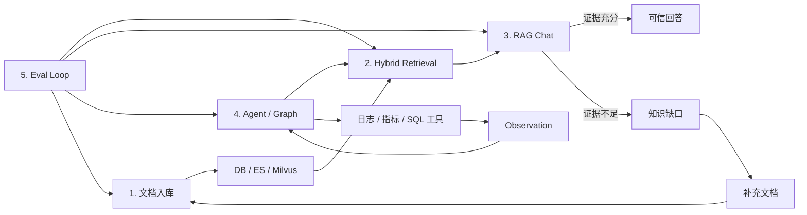

# 项目五条核心链路记忆卡

更新时间：2026-06-24

这份文档不是完整代码走读，而是为了面试前快速回忆项目主线。可以把整个项目记成一句话：

> 入库成证据，检索找证据，回答守证据，Agent 用证据，评测补证据。

对应五条链路：

1. 知识入库与三存储一致性
2. Hybrid + RRF 混合检索
3. RAG Chat、记忆、拒答与知识缺口
4. ReAct / Graph Agent 与 Tool Harness
5. 评测驱动的修复、回归和指标闭环

## 0. 总览口诀

```text
文档进来先切块，DB 拿号是主脉；
ES 管词，Milvus 管意，chunkId 对齐才可信。

用户提问两路查，向量语义 ES 词；
RRF 融合排座次，低置信度不硬答。

RAG 先取证再生成，记忆只做上下文；
证据不足沉缺口，补完文档再回归。

Agent 负责选工具，ReAct 串行看观察；
DAG 拆图可并行，Harness 保底防崩塌。

评测不是跑一次，失败案例要入账；
检查修复再验证，指标闭环才像工程。
```

## 1. 链路一：知识入库与三存储一致性

### 记忆口诀

```text
切、算、写、对、修
```

- 切：把原始文档切成 chunk。
- 算：为每个 chunk 生成 embedding。
- 写：先写 DB，再写 ES 和 Milvus。
- 对：用 chunkId 校验 DB / ES / Milvus 是否一致。
- 修：不一致时通过 Repair API 重建索引。

### 一句话解释

知识入库链路负责把不可检索的文档变成可召回、可引用、可修复的证据单元。DB 是事实源，ES 负责关键词检索，Milvus 负责向量检索，三者通过同一个 chunkId 对齐。

### 输入输出

| 项目 | 内容 |
| --- | --- |
| 输入 | 知识文档、docId、metadata |
| 过程 | 文档切片、embedding、DB 写入、ES 写入、Milvus 写入、一致性校验 |
| 输出 | 可检索 chunk、向量索引、关键词索引、任务状态、修复报告 |

### 关键类

- `KnowledgeIndexServiceImpl`
- `KnowledgeStorageConsistencyServiceImpl`
- `KnowledgeIndexTaskPublisher`
- RabbitMQ Consumer
- Repair API 相关 Controller / Service

### 面试回答模板

> 这条链路的核心不是简单把文档塞进向量库，而是把知识切成稳定的 chunk，并用 DB 生成的 chunkId 作为统一身份。ES 和 Milvus 都使用这个 chunkId，后续才能做去重、引用定位、一致性检查和 Repair。如果三存储数量或 chunkId 不一致，系统可以通过 Repair API 重新清理、写入并验证。

### 容易被追问

- 为什么 DB 要先写？
- 为什么 chunkId 对齐重要？
- Repair API 是重新写一遍，还是“检查 -> 修复 -> 验证”的闭环？
- 为什么不用 Milvus 自己生成的 ID？

## 2. 链路二：Hybrid + RRF 混合检索

### 记忆口诀

```text
向量找意思，ES 找字面，RRF 排座次，metadata 守边界。
```

### 一句话解释

混合检索链路负责从知识库中找到可靠证据。向量召回解决口语化、同义表达和语义泛化问题，ES BM25 解决型号、发票、规则关键词等精确匹配问题，RRF 把两路结果按排名融合。

### 输入输出

| 项目 | 内容 |
| --- | --- |
| 输入 | 用户问题、topK、metadata filter、RetrievalMode |
| 过程 | vector-only / keyword-only / hybrid，RRF 融合，去重，低置信度判断 |
| 输出 | 命中的 chunk、分数、来源、debugInfo |

### 关键类

- `KnowledgeSearchServiceImpl`
- `KeywordSearchServiceImpl`
- `VectorStore`
- `RetrievalMode`

### 面试回答模板

> 我没有只用纯向量或纯关键词。纯关键词容易漏掉口语化问法，纯向量又可能忽略规则里的强关键词，比如“全新未拆封”“无发票”。所以我做了 Hybrid：Milvus 走语义召回，ES 走 BM25，最后用 RRF 按排名融合，避免直接混合两种不同尺度的分数。评测里会看 Recall@5 和 MRR，判断能不能召回以及排得够不够靠前。

### 容易被追问

- 为什么 RRF 比直接加权稳定？
- vector-only、keyword-only、hybrid 分别适合什么场景？
- metadata 过滤为什么会导致召回为空？
- ES fallback 到 MySQL 时，怎么避免误以为 ES 生效？

## 3. 链路三：RAG Chat、记忆、拒答与知识缺口

### 记忆口诀

```text
取证、判证、组装、生成、沉淀
```

- 取证：调用 Hybrid 检索拿证据。
- 判证：判断证据是否足够。
- 组装：拼接证据、记忆、用户问题和系统约束。
- 生成：调用 LLM 生成回答，支持流式输出。
- 沉淀：证据不足时写入知识缺口。

### 一句话解释

RAG Chat 链路负责把检索结果变成用户可读的回答。它不是“有结果就让模型自由发挥”，而是先判断证据质量，再约束模型只能基于证据回答；如果证据不足，就拒答并沉淀知识缺口。

### 输入输出

| 项目 | 内容 |
| --- | --- |
| 输入 | 用户问题、用户/会话信息、历史记忆 |
| 过程 | Hybrid 检索、低置信度判断、Prompt 组装、LLM 生成、后处理、事件发布 |
| 输出 | 流式回答、引用来源、拒答说明、知识缺口记录 |

### 关键类

- `RagChatServiceImpl`
- `ChatGenerationServiceImpl`
- `AgentRuntimeContextBuilder`
- `L2MemoryServiceImpl`
- `KnowledgeGapServiceImpl`
- `RagChatOutcomeEvent`

### 面试回答模板

> RAG Chat 是固定链路：先检索知识库，再判断证据是否足够，最后基于证据生成回答。为了避免幻觉，我加了拒答规则、价格忠实度约束和后处理。记忆系统只作为上下文补充，不能覆盖知识库证据。证据不足或缺字段时，会发布结果事件并沉淀知识缺口，后续补文档后可以做定向回归。

### 容易被追问

- 怎么判断证据不足？
- 怎么避免模型编造价格、折扣和规则？
- L1/L2/L3 记忆分别做什么？
- 知识缺口怎么从一次拒答变成后续治理任务？

## 4. 链路四：ReAct / Graph Agent 与 Tool Harness

### 记忆口诀

```text
ReAct：想、选、调、看、答。
Graph：拆、排、跑、合、答。
Harness：限时、重试、快照、降级、记录。
```

### 一句话解释

Agent 链路负责让系统从“固定问答”升级为“按问题调用工具”。ReAct 适合串行工具推理，Graph/DAG 适合把多个可并行的工具节点拆开执行。Harness 是工具执行保护层，防止单个工具超时或失败拖垮整条链路。

### 输入输出

| 项目 | 内容 |
| --- | --- |
| 输入 | 用户问题、角色权限、Runtime Context |
| 过程 | Planner 选工具、权限校验、Harness 执行、Observation 汇总、最终回答 |
| 输出 | 工具调用结果、Trace、Observation、最终解释 |

### 关键类

- `ReactAgentServiceImpl`
- `GraphReactAgentServiceImpl`
- `AgentTool`
- `AgentToolRegistry`
- `ToolExecutionHarnessImpl`
- `AgentRuntimeContextBuilder`

### 面试回答模板

> ReAct 和 Graph 共用同一套工具、权限和 Harness，只是调度方式不同。ReAct 更像线性流程：选择工具、调用工具、观察结果、再回答。Graph/DAG 会把任务拆成节点，通过入度和依赖关系调度，入度为 0 的节点可以并行执行。Harness 负责超时、重试、Redis 快照恢复和 fallback，让工具失败时返回结构化 Observation，而不是直接 500。

### 当前边界要说清

当前 Agent 主链路不是原生 Spring AI Function Calling，而是自定义 Planner + Tool Registry + Harness。面试时可以说“实现了 ReAct-style 工具编排”，不要说“所有工具都由模型原生 Function Calling 自动选择”。

### 容易被追问

- ReAct 和 DAG 的区别是什么？
- DAG 是不是只是为了提速？
- 普通用户能不能调用日志、Prometheus、MySQL 工具？
- Harness 和业务工具有什么区别？
- Function Calling 和当前工具抽象是什么关系？

## 5. 链路五：评测驱动的修复、回归和指标闭环

### 记忆口诀

```text
测出问题，记录问题，修复问题，回归问题，量化问题。
```

### 一句话解释

评测链路负责证明项目不是主观 Demo。它用数据集和脚本持续检查检索、生成、Agent、Harness、记忆、存储一致性、异步入库、AIOps 修复和知识缺口治理。

### 输入输出

| 项目 | 内容 |
| --- | --- |
| 输入 | eval dataset、接口返回、Trace、任务状态 |
| 过程 | 调接口、做断言、统计指标、生成报告、发现失败 case |
| 输出 | eval report、pass rate、Recall/MRR/P95、失败原因、回归结果 |

### 关键脚本方向

- retrieval eval：看 Recall@K、MRR。
- RAG Chat eval：看 Source Hit、拒答准确率、回答约束。
- ReAct / Graph eval：看工具选择、Trace 完整率、Observation 使用率。
- Harness eval：看重试、超时、fallback、快照恢复。
- storage consistency eval：看 DB / ES / Milvus chunkId 对齐。
- knowledge gap eval：看拒答沉淀、补文档、自动回归。
- AIOps / runbook eval：看诊断、修复后验证、失败转人工、MTTR。

### 面试回答模板

> 我不是只人工点接口看效果，而是给每条 AI 链路都写了评测脚本。检索看 Recall@K 和 MRR，RAG Chat 看引用命中和拒答准确率，Agent 看工具选择和 Observation 使用，Harness 看故障注入下的重试和降级，知识库治理看三存储一致性。失败 case 会进入知识缺口或修复任务，补完后再做回归。

### 容易被追问

- 为什么 RAG 不能只靠主观体验判断？
- hard case 怎么构造？
- 修改测试集让它通过是否合理？
- 评测报告怎么反向驱动知识更新？
- P95、MTTR 这类指标分别说明什么？

## 6. 五条链路如何串成闭环



可以把闭环讲成三层：

1. 知识层：文档入库、chunk、embedding、ES/Milvus、Repair。
2. 问答层：Hybrid 检索、RAG Chat、拒答、知识缺口。
3. 编排层：ReAct/Graph、工具、Harness、Trace、AIOps。

评测层贯穿三层，用来证明系统是否真的可用。

## 7. 30 秒总回答

> 这个项目可以按五条链路理解。第一条是知识入库，把文档切成 chunk，并通过 DB、ES、Milvus 三存储对齐保证证据可靠。第二条是 Hybrid 检索，用 Milvus 做语义召回、ES 做关键词召回，再用 RRF 融合。第三条是 RAG Chat，基于证据生成回答，证据不足就拒答并沉淀知识缺口。第四条是 Agent 编排，ReAct 做串行工具调用，Graph/DAG 做可并行调度，Harness 负责超时、重试和降级。第五条是评测闭环，用多套脚本检查召回、生成、工具调用、存储一致性和修复效果，让问题能被发现、修复并回归。

## 8. 逐层背诵顺序

第一遍只背主线：

```text
入库 -> 检索 -> 回答 -> 工具编排 -> 评测治理
```

第二遍背每条链路的关键词：

```text
入库：chunkId、DB 事实源、ES、Milvus、一致性、Repair
检索：vector、keyword、Hybrid、RRF、metadata、Recall/MRR
回答：证据、拒答、价格忠实度、记忆、知识缺口
Agent：ReAct、DAG、Tool、Permission、Harness、Trace
评测：dataset、assertion、report、P95、回归、闭环
```

第三遍背面试风险点：

```text
不要把 RAG 说成 Agent。
不要把当前 Agent 说成原生 Function Calling。
不要把 Harness 说成业务工具。
不要把 Repair 说成简单重试。
不要把记忆说成比知识库证据优先。
不要只说实现，要说为什么这样设计、怎么评测、失败怎么处理。
```

